<iframe src="https://www.youtube.com/embed/RGxaF-tW7Sk" title="YouTube video player" frameborder="0" allow="accelerometer; autoplay; clipboard-write; encrypted-media; gyroscope; picture-in-picture; web-share" referrerpolicy="strict-origin-when-cross-origin" class="w-full aspect-video rounded-2xl overflow-clip"></iframe>

 

The [Fisher Price Laugh & Learn Game & Learn Controller](https://www.walmart.com/ip/Fisher-Price-Laugh-Learn-Game-Learn-Controller-Musical-Baby-Toy-with-Lights-Green/1589987139) is a $10 toy in the shape of a handheld game controller. It has a D-pad and four additional buttons, and is powered by AAA batteries. Since it already has a shell, buttons, and power, it would seem like this would be relatively easy to turn into a functioning game controller.

As it turns out, there's plenty of space inside the enclosure for another microcontroller, Bluetooth, and the extra wiring we need to make it work! And while it's certainly not the most ergonomic controller I've used, it's fully functional (as long as you don't need trigger buttons or an analog stick).

## Taking a first look

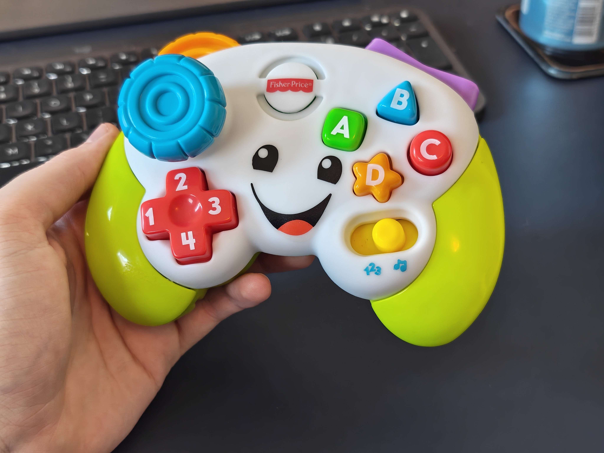

The Fisher Price controller has eight working buttons (the numbered D-pad and the letter buttons), a toggle switch, and an "analog stick" that in reality only gives a digital signal when it is moved away from the center position. It does not have trigger buttons: the orange wheel on the left produces a ticking sound when rotated but has no electrical contacts, and the purple switch on the right will move between two positions but also does not have contacts. It has a speaker and an RGB LED.

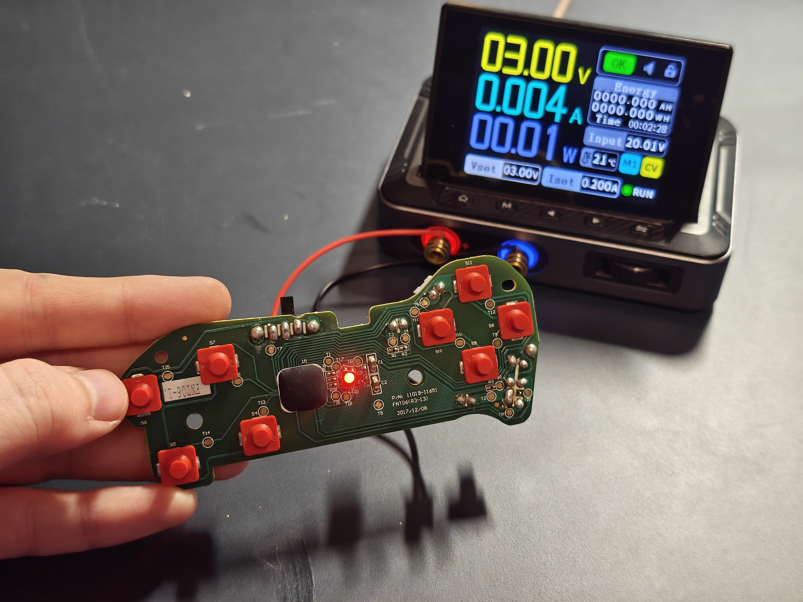

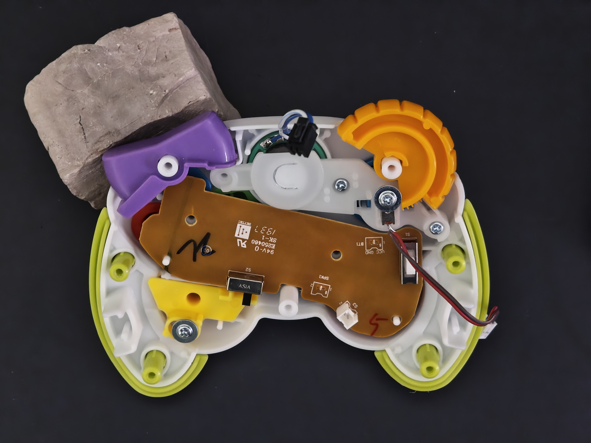

The controller has a single internal PCB. It's a single-layer board, with membrane buttons and switches directly soldered on. The fake analog stick, speaker, and batteries are broken out to 0.1" connectors on the opposite side of the board. (Two out of three connectors pulled the housing off of the board when I tried to disconnect them.) The board also has some passives and the LED as surface-mount components.

Unfortunately, the main microcontroller for the board is buried under epoxy, a technique known as [Chip-on-board](https://en.wikipedia.org/wiki/Chip_on_board). Fortunately, though, there are plenty of plated test points scattered throughout the board layout.

My first step in reverse-engineering this board was to hook up power in place of the battery terminals, running it through a current-limited supply to make sure any short circuits did not damage the board. From here, I used a multimeter to measure the voltage at test points when I pressed buttons, and used tweezers to force certain test points to ground to test the LED.

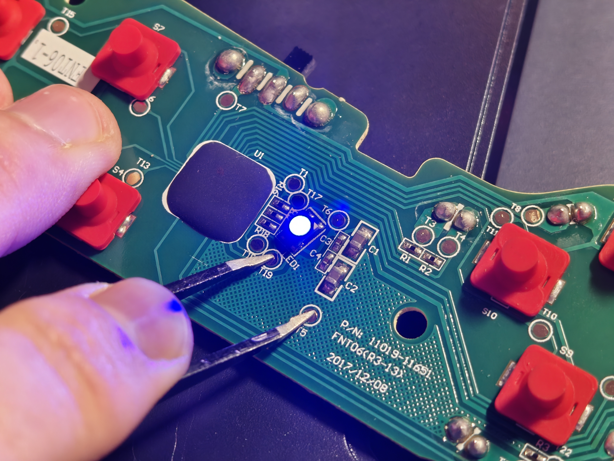

## Selecting a microcontroller

Since we need to add Bluetooth functionality, and since the existing microcontroller is a black blob we can't upload code to (without tons of effort), the easiest solution here is to add our own microcontroller and rewire the buttons to it. I chose the [nRF52840](https://www.nordicsemi.com/Products/nRF52840) by Nordic Semiconductor -- it has Bluetooth LE support, works with the Arduino IDE, and importantly, it consumes much less power than the ESP32 series from Espressif which will help our battery life.

I chose Adafruit's [ItsyBitsy Express](https://www.adafruit.com/product/4481) breakout board form factor for its compact size and built-in LDO regulator. Since the controller has 3 AAA batteries, our stuff needs to run on 4.5 V. The ItsyBitsy board has an [AP2112](https://www.diodes.com/assets/Datasheets/AP2112.pdf) regulator onboard to step the battery voltage down to 3.3V. It's a linear regulator, so it wastes a bit of power, but the power consumption of the nRF52840 should be low enough for it to not matter.

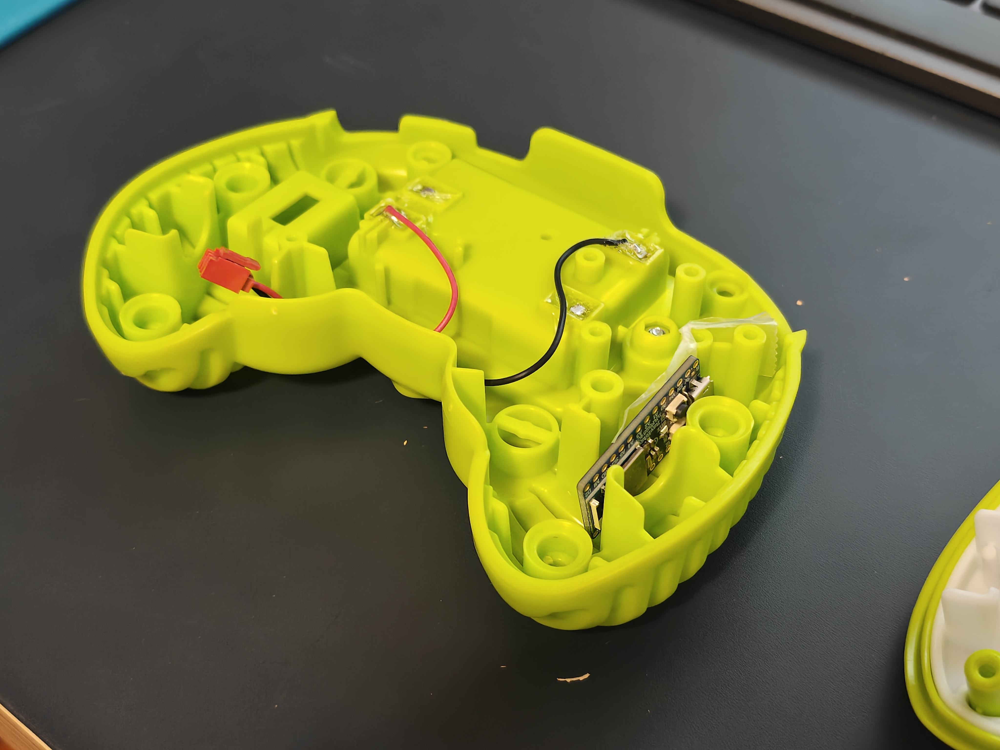

I was initially planning on mounting the ItsyBitsy board to the back of the controller's existing PCB, but it turns out that the battery compartment protrudes substantially into that space and does not give enough vertical clearance. I did find, however, that the board fits nicely into an empty space in the right side hand grip. This allows wiring between the ItsyBitsy board and the controller's board to run along that side.

## Wiring setup

The easiest wires to run were the battery wires, since they didn't cross between halves of the controller. (However, I later ended up redoing this to use the slide switch as an on/off selector...)

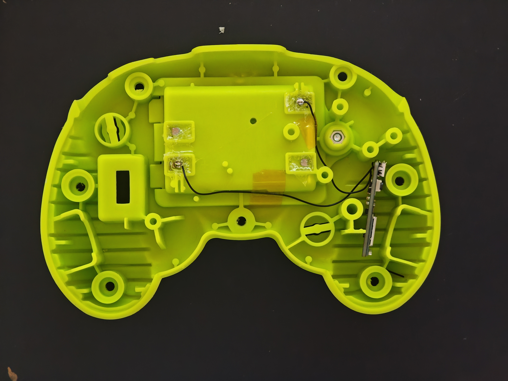

The battery terminals are glued in. Although four tabs are visible, two are just there to mechanically hold in place the terminals that keep the batteries in series. We only need to wire to the two ends of the series chain.

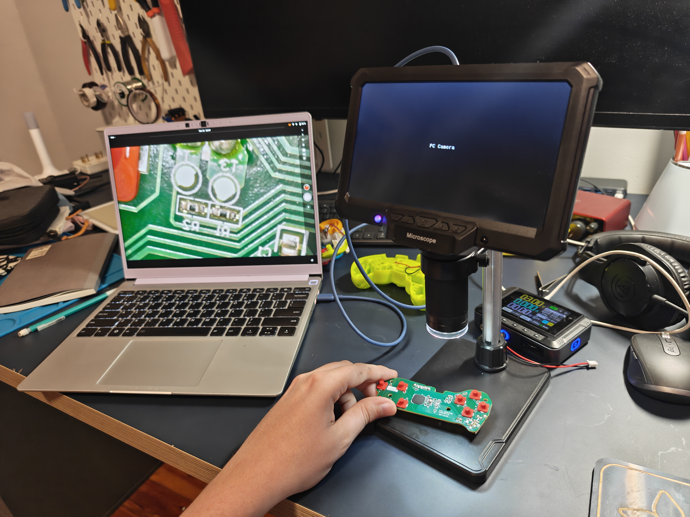

I finally bought a digital microscope by the way! It's about the cheapest one out there, but it's still quite useful. I'm going to take advantage of it to put in some nice close-up shots in this post.

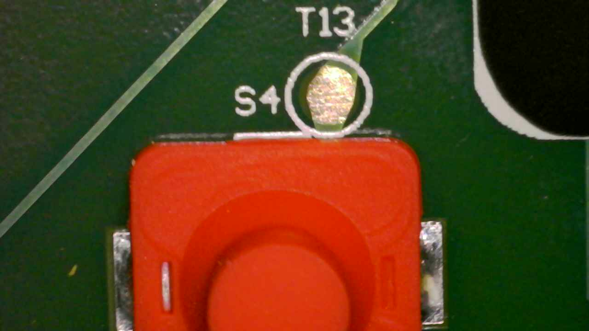

Most testpoints are quite obvious to figure out -- they're placed directly next to the switch they connect to, and the trace on the PCB connecting the two is obvious. To wire our microcontroller up, we solder from these testpoints to the microcontroller.

## Cutting traces

We don't want the microcontroller on the board to continue to drive the peripherals like the buttons. If this were a packaged chip, we could remove it with a bit of hot air, but since it's epoxied, it would be difficult to get off without strong solvents or similar approaches. I decided the easiest thing to do would be to cut as many traces leading into the chip as possible.

When cutting traces, you'll first scrape off the soldermask, revealing the copper layer. Then, continue scraping through the copper into the fiberglass underneath to make sure the connection is broken.

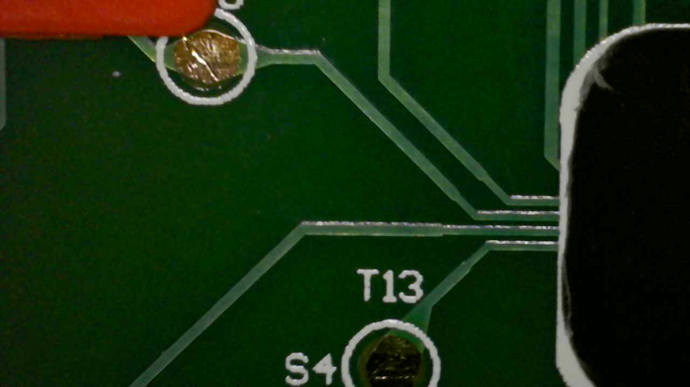

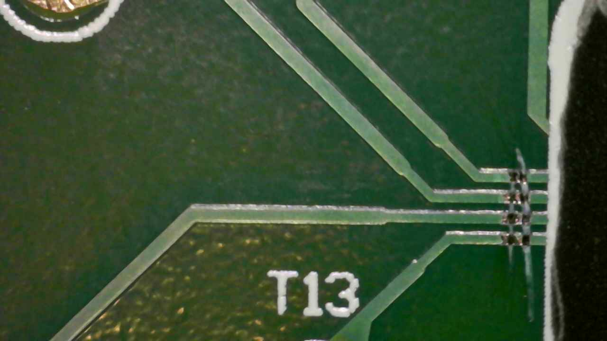

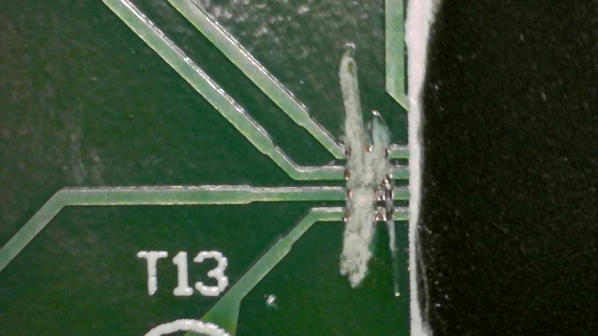

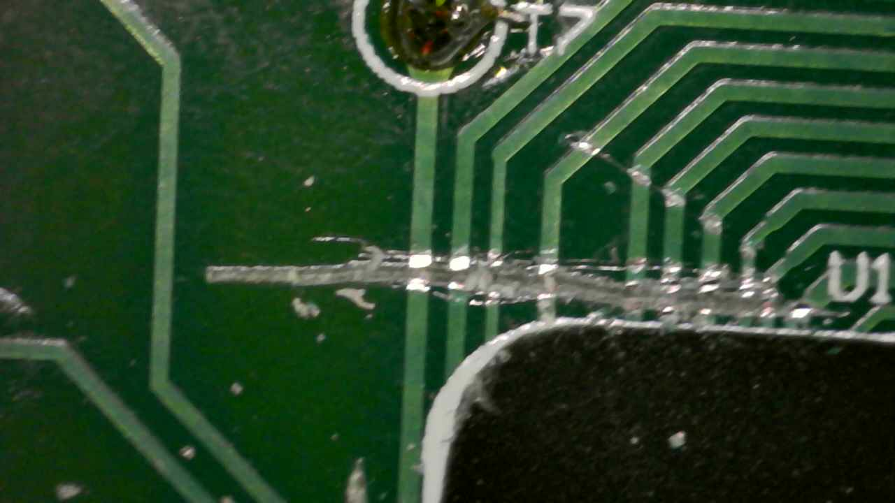

## Soldering to testpoints

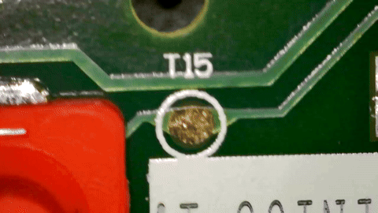

I used 30 AWG wire to solder connections between the controller's PCB and the nRF52840 board. The testpoints make it really easy: just deposit a blob of solder onto the testpoint, and with it hot, push your wire into place.

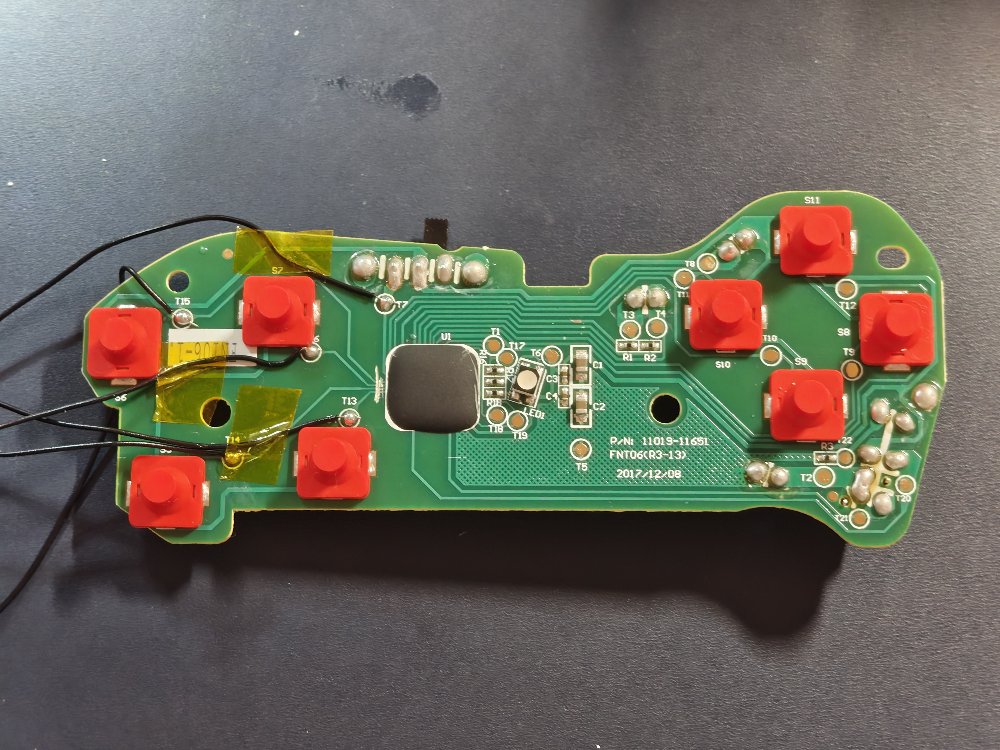

I tried using some [Kapton tape](en.wikipedia.org/wiki/Kapton#Electronics_manufacturing) to hold the wires in place and prevent them from interfering with the screw holes or buttons.

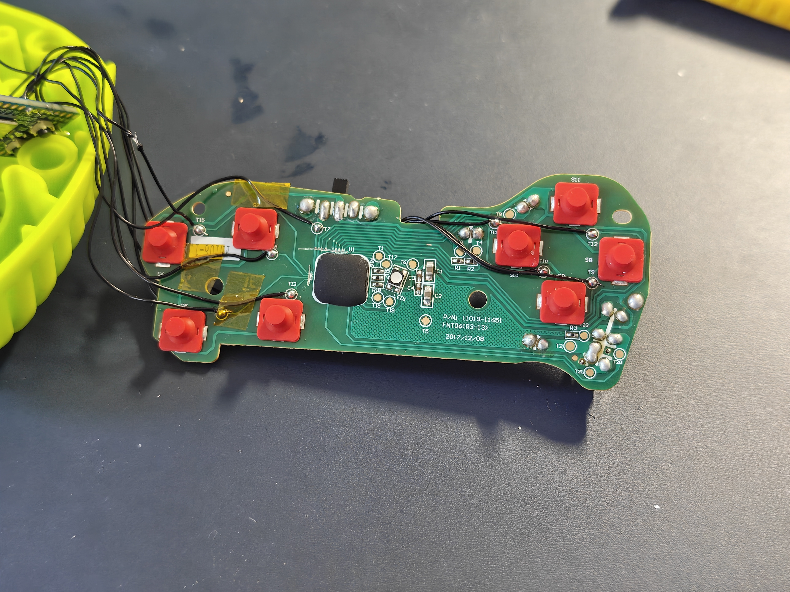

Once all the buttons were wired up, I reassembled the controller to test everything out. The wiring lengths were dictated by my desire to open the controller up "like a book" to make wiring and assembling it easier.

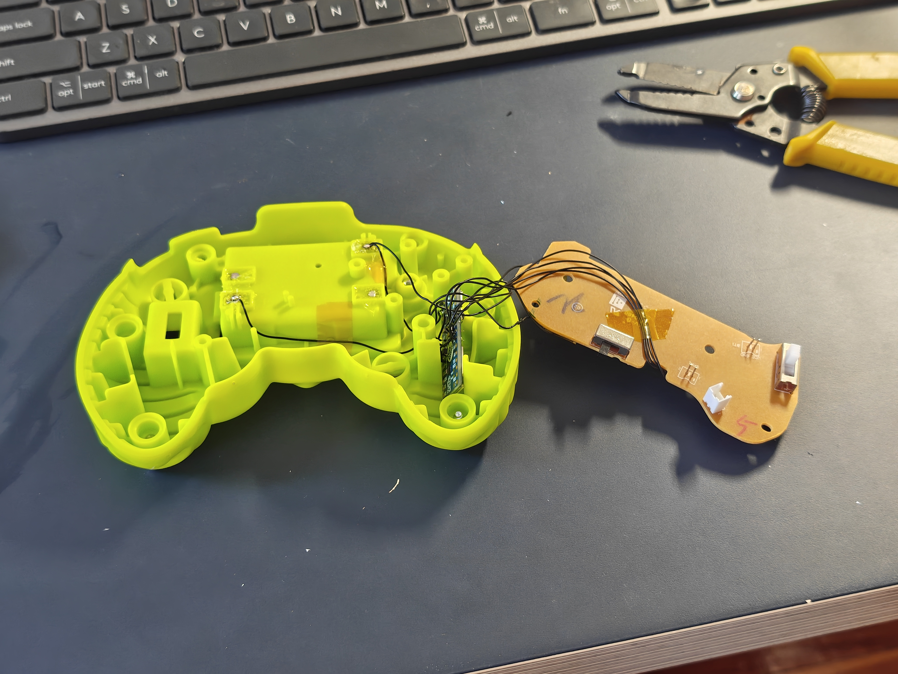

After the first round of testing, I went back in to attempt to get the power switch and front LED working. Unfortunately, the position of the epoxy glob and traces made it difficult to electrically cut off the original microcontroller from the LED circuit, and although I tried getting the LED to work, it ended up creating a short whenever it was used and causing my power supply to go into current-limiting mode (or on one occasion, causing me to end up with some very hot AAAs).

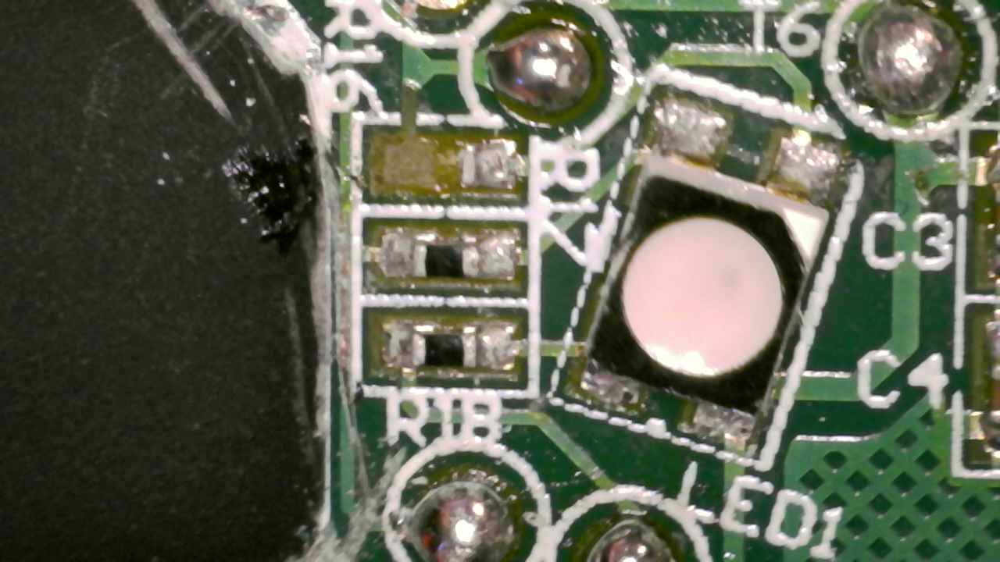

That said, I was able to get the power switch to work! I cut off the power trace leading to the rest of the circuit, and was able to connect one lead to a test point and the other directly to one pin of the switch.

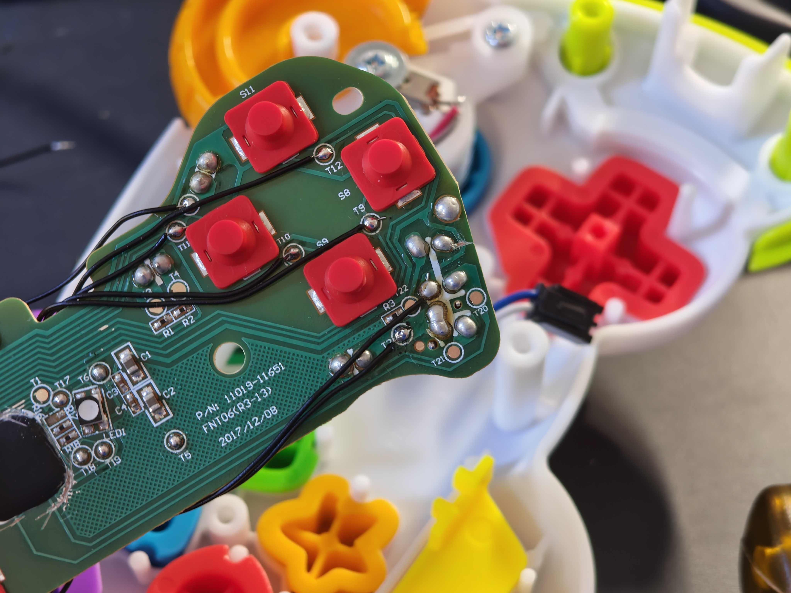

## Firmware and testing

The D-pad and the four buttons are the easiest to conceptually map to actual controller inputs. The toggle switch does not seem useful -- although I suppose it could switch between different modes of operation, no actual controller I know of seems to do that, so I didn't bother wiring it up. The fake analog stick does act as a usable button but is not convenient to use while gaming. I mapped it to the center ("Xbox logo") button, but it's also easy to bump by accident which kept bringing up Steam Overlay so that might not have been a good choice.

The firmware for this was one-shotted by an LLM, there's nothing terribly novel about writing BLE gamepad firmware for an nRF52840, and I really wanted to focus on the hardware of this project rather than the firmware.

It shows up as a normal Bluetooth gamepad and works as expected in games. The lack of an analog stick is definitely limiting, but it would work well for PICO-8 games, games for the NES or PS1, etc. It works decently well for Celeste with the exception that the lack of a shoulder or trigger button makes climbing really annoying (you have to map it to a different button under your right thumb).

## Other work

I intentionally avoided looking at existing work when planning my mod, since I wanted to show what the reverse engineering process looks like without getting hints from existing writeups. I am definitely not the first person to attempt a project like this! Some interesting examples I found include:

- [`@rudeism`'s mod](https://x.com/rudeism/status/1520874547205271553), which turns the fake analog stick into a fully functional one. They left the existing board inside, too, which gives you some interesting sound effects during games. They chose to convert it into a wired controller with USB, which frees up lots of space internally which would previously have been used for the battery compartment.
- [Retrograde Scene's build](https://www.youtube.com/watch?v=BAL5vDuB_Yc) also removes the battery compartment to add space, but adds a rechargeable Li-Po battery. They used an ESP32, which gives more options for breakout boards but higher power consumption than the nRF52 series of chips.
- [Adafruit's guide](https://learn.adafruit.com/fisher-price-usb-controller/overview) to modding this controller uses an RP2040 chip with the [GP2040-CE](https://github.com/OpenStickCommunity/GP2040-CE) firmware to make a wired USB controller.

## Conclusion

This was really fun to build! The actual wiring work went pretty quickly, and it was a great way for me to get my new desk set up with soldering gear.

Having it around as a controller also just has a way of sparking joy. It's really fun to bring up a game on your laptop and hand the controller to a friend, for instance.

Between this project and the [portable Meshtastic node](/projects/meshtag) I made earlier this year, I've definitely discovered how fun building small, portable devices can be. Building small things presents lots of interesting engineering challenges, and it's nice to have a result you can carry around and show off to friends.

For now, the controller has earned its spot in our living room TV console, ready to be used for retro gaming, as a PowerPoint clicker, or just as a remote for our smart TV.
